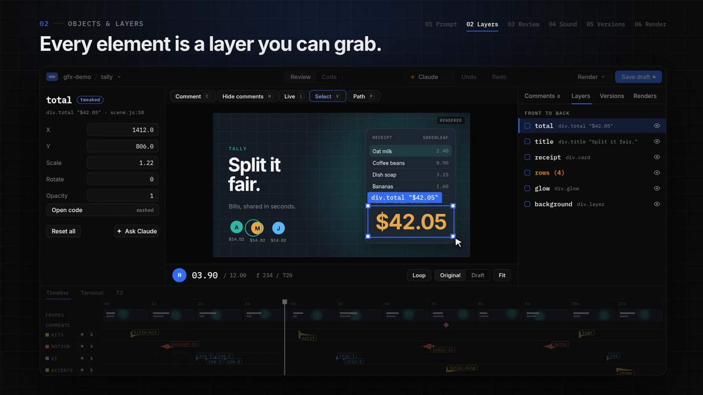

# agent-gfx

<p align="center">
  
</p>

<p align="center">
  <a href="#install">install</a> · <a href="#quick-start">quick start</a> · <a href="#docs">docs</a> · <a href="examples/gfx-demo">example</a>
</p>

<p align="center">
  <a href="LICENSE"></a>
  <a href="https://github.com/geronimonzy/agent-gfx/stargazers"></a>
  
  
</p>

---

[](docs/media/agent-gfx-demo.mp4)

<p align="center"><sub>the demo (38 s, with sound) was made in agent-gfx too: <a href="examples/gfx-demo">examples/gfx-demo</a></sub></p>

**motion graphics, directed with your coding agent.**

- **describe it, the agent builds it** — scenes are plain code (three.js, canvas 2D, SVG or anime.js). agent skills
  storyboard, build, check and render them, so you ask for a 12 s launch reel and get one.
  [skills →](.claude/skills/motion-graphics/SKILL.md)
- **every element is a layer you can grab** — select, move and scale in the live view, scrub the timeline, open the
  code behind any element. [review →](docs/REVIEW.md)
- **review on the frame** — draw on the picture, leave a comment, send it to the agent. your tweaks are override layers,
  not code edits, until you apply them.
- **sound that follows the motion** — synth SFX cues placed in the scene, stems, a loudness-normalised mix, and a CC0
  sample library with text search. [sound library →](docs/SOUND-LIBRARY.md)
- **looks** — reusable styles: palette, type, motion rules and a sound palette. six starters, or let the agent build one
  from your references. [looks →](docs/LOOKS.md)
- **every change is a version** — git-backed history, compare two versions frame by frame, undo what the agent did.
  [versions →](docs/CODE-VERSIONS.md)
- **same frames, every render** — `render(t)` is a pure function of time: Exact mode is byte-identical, Fast mode runs
  on the GPU. MP4, WebM, GIF, ProRes, alpha, crop and reframe. [render options →](docs/FOUNDATION.md)
- **your agent, your terminal** — gfx studio has a built-in terminal for Claude Code (or Codex, pi…) and a link to
  [T3 Code](https://github.com/pingdotgg/t3code). [agent in the app →](docs/CLAUDE-IN-APP.md)

---

## install

windows installers (studio + engine, no node setup) will be on the [releases](https://github.com/geronimonzy/agent-gfx/releases)
page: one for projects in windows folders, one for projects inside WSL. details: [docs/INSTALL.md](docs/INSTALL.md).

from source (engine; node 20.19+ or 22.12+, put `bin/` on your PATH):

```bash
git clone https://github.com/geronimonzy/agent-gfx
cd agent-gfx
npm install
gfx doctor            # node, browser, ffmpeg, sound library
gfx setup ffmpeg      # if ffmpeg is missing
```

## quick start

```bash
gfx init ../my-project --template reel
cd ../my-project
gfx dev reel                   # live preview
gfx render reel --audio        # out/reel/reel.mp4 + reel.sound.mp4
```

then open the project in Claude Code and ask for an animation; the `motion-graphics` skill takes it from there. `gfx`
with no arguments lists every command.

> early and windows-first. on linux the engine runs from source; the studio app is untested there. macOS comes later.

## docs

[scene contract + CLI](docs/CONTRACT.md) · [studio](docs/STUDIO.md) · [review](docs/REVIEW.md) ·
[looks](docs/LOOKS.md) · [look pipeline](docs/LOOK-PIPELINE.md) · [templates](docs/TEMPLATES.md) ·
[sound library](docs/SOUND-LIBRARY.md) · [sound tweaks](docs/SOUND-TWEAK.md) · [versions](docs/CODE-VERSIONS.md) ·
[visual diff](docs/VISUAL-DIFF.md) · [engine, windows, render options](docs/FOUNDATION.md) ·
[agent in the app](docs/CLAUDE-IN-APP.md) · [T3 Code](docs/T3.md) · [layout](docs/LAYOUT.md) ·
[keyboard](docs/KEYS.md) · [install](docs/INSTALL.md)

## agent instructions

if you are an AI agent helping with this repository, read [`AGENTS.md`](./AGENTS.md) before making changes and
[`CONTRIBUTING.md`](./CONTRIBUTING.md) before opening issues or PRs.

## development

```bash
npm run studio:dev             # the studio UI in a browser with a dev shim (http://127.0.0.1:5177)
npm run studio:build           # the web build used by the windows app
node tests/project.test.mjs    # engine tests: tests/*.test.mjs
```

the windows app is a Tauri v2 project in `apps/studio/src-tauri` (Rust + WebView2): `cargo build --release` on windows
after `npm run studio:build`, or `apps/studio/scripts/build-win.sh` from WSL.

## license

agent-gfx is licensed under the [MIT License](LICENSE). third-party components, fonts, sounds and downloaded tools keep
their own licences: [THIRD_PARTY_NOTICES.md](THIRD_PARTY_NOTICES.md) (also in the studio under Settings → About).
